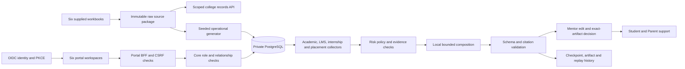

# AURA: final implementation and operating report

12 October 2026. The project now has a hosted college-project edition at the six existing Vercel URLs, alongside the private local edition. It combines supplied college exports with generated operations and individual password accounts. See `HOSTED_PROJECT_RELEASE_REPORT.md` for the current release map and hosted acceptance. College certification and verified real-world family/faculty relationships are not asserted.

## Delivered scope

| Workspace | Working capabilities |
|---|---|
| Student | Own dashboard, course registration, timetable, progress/results, confirmed support and original college source records |
| Parent | Linked student progress, attendance, results, field-controlled access, mentor updates, project payment records and receipts |
| Faculty | Assigned classes/students, attendance and assessment management, support planning, exact-version edits/approval, intervention outcomes and withdrawal |
| HoD | Department people, courses, timetable, mentor assignments and department support trends |
| AI Operations | Review planning/execution, job history, evidence export and recorded-run verification; academic writes and mentor decisions denied |
| LMS | Enrolled courses, lessons, assignment submission and feedback through the same Student identity |

Native portal copy, metadata and account entry flows were updated for normal product use. No blanket generated-data or demo-only banners appear in project mode. Source meanings remain visible as unknown where that affects interpretation. The fee flow states that no money is collected because it has no live payment provider.

The interface uses the existing restrained AURA design: consistent workspace navigation, serif page titles, readable tables and forms, responsive source selection, visible operation feedback and brief entry/transitional motion. Reduced-motion preferences suppress motion. This is an academic workspace, so animation supports navigation rather than replacing it.

## Data used

The verified Downloads inventory contained twelve XLS copies representing six distinct workbooks, rather than ten distinct CSVs. All six unique supplied reports were used. No additional external dataset was acquired.

| Imported evidence | Quantity |
|---|---:|
| Distinct students | 321 |
| Full attendance rows | 328 |
| CIE rows | 67 |
| Recorded attendance cells | 5,188 |
| Recorded CIE fields | 2,077 |
| Total preserved values | 7,265 |

Original source files remain byte-for-byte intact. Each record retains its source hash and cell reference. Independent workbook readers agreed on 10,287 workbook cells during import validation. Parsing preserves values such as 0, NA, TNS, dash and blank without assigning unsupported meanings.

Original academic year, reporting period, attendance units, absence codes, CIE maxima and aggregation rules remain unknown. Generated semester operations are separate records. They do not establish the meanings of the college export or reinterpret those raw numbers as percentages.

Generated support includes 647 unique-password project accounts: 321 Students, 321 linked Family accounts, three mentors, one HoD and one Operations account. It creates three course offerings, 963 registrations, 30 attendance sessions, 9,630 attendance records, 963 marks/results, LMS lessons/assignments/activity, fee invoices and career signals. Each mentor has 107 students. Foreign keys, stable seeded identifiers and role relationships keep the generated layer coherent. Initial setup is atomic; subsequent starts preserve edits.

These are functioning project identities and generated relationships. Account creation does not verify a real parent's relationship, a real faculty assignment or institutional permission. Provenance is retained in storage and this documentation.

## How the system works

The browser never supplies its own trusted role. The identity service authenticates the password, issues the OAuth authorization code with PKCE, and the portal establishes its protected session. Its BFF forwards authenticated requests. Core resolves the current role and assignment from stored relationships, enforces scope and records command receipts. Writes use CSRF protection, command idempotency and expected revisions to reject stale updates.

The private edition binds its eight application processes and PostgreSQL to 127.0.0.1, port 55432/database `aura_project`. The hosted edition uses eight existing Vercel projects and separate Core/Identity schemas in the approved remote PostgreSQL database. A fail-closed configuration guard pins the remote database host/name, schema pair and `college-project` identity realm, requires TLS and rejects local URLs. Existing demonstration schemas are preserved for rollback.

Named records were uploaded only after the user explicitly authorized individual-account access at the existing URLs. Public sign-up and PINless entry are disabled in the hosted realm. Password hashes and subject bindings were copied; local sessions, tokens and encrypted signing keys were not. Runtime secrets, credentials, browser traces and private source exports are excluded from deployment inputs. Source API responses require authentication and current scope. An unused copied provisioning identity has no active password. Its metadata remains for provenance, outside the 647 project accounts.

Local secrets exposed during an earlier diagnostic were rotated. Hosted acceptance later exposed an encrypted Mentor portal session cookie through a Playwright call log; the harness now strips those logs and the affected portal session key was rotated in the corrective release.

## Agent pipeline

1. An authorized mentor chooses students, a domain and an approved policy. Vague requests generate planning questions. A ready plan is locked before execution.
2. Academic, LMS, internship and placement collectors read scoped evidence. A short shared capture transaction records the institution revision. Nested reads share its database connection, preventing pool starvation. Later writes cannot retroactively change that evidence revision.
3. Completeness, freshness, term and source checks determine whether execution can proceed. Unknown or missing evidence does not become an invented measurement.
4. Policy rules calculate risk and applicable bounded support actions. The language model may select/order allowed actions and choose timing. It cannot invent factual prose, diagnose a student, approve a plan, contact anyone or change academic records.
5. Structured-output, citations and authority checks validate the packet. Invalid output enters bounded diagnosis/repair or an explicit deterministic fallback. Stored modes distinguish actual model execution from fallback.
6. Jobs persist checkpoints and leases. Each request handles up to four students; larger plans continue over bounded requests. Restart recovery and duplicate execution are covered by database integration tests.
7. An assigned mentor can edit a packet, save a new validated artifact version and approve the exact artifact ID/hash at the expected revision. A stale approval receives a conflict. Drafts remain private. Approved interventions become visible to the Student and authorized Parent.
8. A mentor records outcomes or withdraws publication. Audit history stays intact. Operations can verify recorded input/output hashes and recompute policy/validation checks. This verifies recorded execution; it does not rerun nondeterministic model inference.

The full final cohort cycle processed 321 students in nine plans: 161 proposals awaiting mentor review and 160 unflagged. It used two actual calls to `qwen3.8:27b-mlx` and 159 validated profile reuses. Reuse applies only to action ordering/timing with matching policy/signals/action codes; each student's facts and citations are rebound to their own evidence. Acceptance testing subsequently approved representative cases, so the live pending count is lower than the original 161. No real institutional approval is claimed.

Raw workbook evidence is available in scoped source views and lineage. Support risk is calculated from the separate generated operational records because the original units remain unknown.

## Planning and review

Fable Thinking produced the plan and its adjustment in `PROJECT_FINALIZATION_PLAN.md`. The main adjustments were keeping ambiguous raw evidence separate, choosing private local PostgreSQL, retaining real authentication and exact-artifact approval, and distinguishing generated project identities from verified institutional access.

The gstack router and browser workflow were applied with the documented headless-browser fallback. Authenticated acceptance used the project's Playwright harness. No gstack autoplan, outside review or public shipping run was claimed. See `GSTACK_VERIFICATION.md` for browser evidence and durable operating lessons.

The architecture audit reviewed data/tool/authority boundaries and resulted in these fixes:

| Finding | Resolution |
|---|---|
| Project model could point off-device | Loopback-only provider and runtime settings; model HTTP redirects rejected |
| Snapshot could inherit a later institution revision | Persist captured evidence revision; share one short capture transaction; recover old checkpoints by recollection |
| Revoked Parent grants leaked source metadata | Filter records and report metadata by current field grants; no records/sources when all relevant grants are revoked |
| Direct service/wrapper could select another database | Pin local flag, host, port, database name and schema at owning configuration boundaries |
| Legacy fixture commands could reset project data | Dedicated project guards reject demo reset/population/legacy execution while allowing the project payment ledger |
| Automated acceptance outran sign-in/logout/data rendering | Pace sign-ins, await logout completion, load the correct workspace route and wait for data/animations before screenshots |

Hosted acceptance found a staff-source timeout caused by per-student database authorization requests. Staff authorization now uses one scoped query inside a read snapshot; hosted database checks measured about 0.6 seconds for 107 Mentor or 321 HoD source records. Local checks and platform builds remain distinct from actual hosted acceptance and institutional authorization.

## Verification and evidence

The private evidence directory is `runtime/project-final/`. Final manifests identify the consumed source and archive fingerprints. Successful verification includes:

- Lint, type checking and builds of all six portals, identity and Core services. Seven platform tests and 60 Core tests passed; six opt-in database tests were skipped in the default command.
- Platform and Core unit tests, plus the dedicated PostgreSQL integration test for policy, evidence capture across restart, edit/approval, replay, duplicate execution, outcomes and mentor transfer.
- Ten Python parser checks; original workbook hashes, 321-student map and 7,265-value preservation.
- Actual project-account OIDC sign-in across all six portals; source scope of one Student/Parent, 107 Faculty students and 321 department students. Operations sees aggregate original-source information without individual raw records.
- Source layouts at 320, 375, 768, 1024 and 1440 pixels; workspace layouts at 320, 375 and 1440; automated Axe checks for serious/critical violations; reduced-motion media behavior; no application page exceptions.
- Student peer denial, LMS activity/submission persistence, mentor edit and stale decision denial, approval visibility, withdrawal/restore, Operations edit denial, recorded-run verification, Parent test payment/receipt and logout session invalidation.
- Private source table update rejection and Parent source-grant revocation with exact restoration.

Coverage is representative, not exhaustive over every record or browser. Manual screen-reader assessment, a historical visual baseline, production load testing and cross-browser certification were not performed. All six conditional database suites were also run against isolated disposable schemas and passed.

Dependency audit found zero production dependency vulnerabilities and five high findings in the development lint dependency chain through `braces`. The audit offered a major downgrade of eslint-config-next rather than a safe patch. The dependency chain is retained and documented; it is not treated as a clean audit.

## Handover and remaining inputs

Use `PROJECT_RUNBOOK.md` for setup, credentials, ports, agent execution and the presentation route. The private delivery ZIP contains source plus the six preserved originals and parsed source inputs. It excludes current credentials, environment files, database cluster, model weights and build dependencies. A fresh install provisions new credentials and operational dates. Keep the ZIP private because it contains college student records.

Nothing further is required to run the private edition or use the hosted project-account workspaces. New hosted model inference still needs a reachable funded provider. Vercel AI Gateway rejected the actual probe because no card is on file. Recorded Qwen inference retains its original local lineage; it is not claimed as cloud inference. For actual institutional rollout, the remaining inputs are precise: official source definitions/periods, verified account and Parent/mentor mappings, an authorized academic policy and coordinator approval, and approved hosting/model/payment/messaging configuration if those services are required. The separate institutional mode remains gated on those inputs. Generating data cannot substitute for those permissions.

The account-wide budget ceiling was 30%. The previous local phase started at 10% and completed at 13%. Hosted work started at 14%; see the hosted release report for its completion reading. The account observation is recorded in `runtime/project-final/FINAL_VERIFICATION.json`. These shared readings are approximate account observations, not exact project costs.
