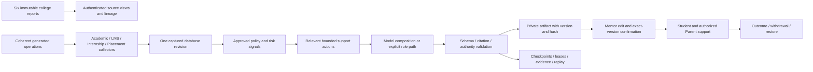

# AURA hosted project release report

12 October 2026. The six existing public portal URLs now serve the college-project edition behind individual password accounts. Core and Identity are deployed too. Named-data upload was explicitly authorized by the user. This report separates tested application behavior, historical model inference and the remaining cloud-provider prerequisite.

## Release map

| Component | Source commit | Immutable deployment |
|---|---|---|
| aura-ai-governance | `314407b` | [dpl_56Evqw1tp7oLi3XVrxhsYo5g4q7Q](https://aura-ai-governance-53un6hiaj.vercel.app) |
| aura-core-api | `64e4287` | [dpl_EGVJmYbXzLZ9GLo7GVNg33KyVu9U](https://aura-core-51awut9wj.vercel.app) |
| aura-faculty-portal | `64e4287` | [dpl_61ggK9hq3mEhT1Q3DUiH7BEkyRTZ](https://aura-faculty-portal-nwr6ixko0.vercel.app) |
| aura-hod-portal | `314407b` | [dpl_FZzgQsa8Hih66K1dqY7kYffFy22t](https://aura-hod-portal-63ejhftkx.vercel.app) |
| aura-identity-service | `314407b` | [dpl_DxxZpYq3pK2EKGkvQNrX92iWmgMs](https://aura-identity-service-81wo12ato.vercel.app) |
| aura-lms-portal | `314407b` | [dpl_AzfoCnuuY8JTnwTWGtYr1kSgHDig](https://aura-lms-portal-atpe4nf6b.vercel.app) |
| aura-parent-portal | `314407b` | [dpl_Ff83zKyeSSmg7Nf9pUY4CzSGqa9D](https://aura-parent-portal-bt5myrlm9.vercel.app) |
| aura-student-portal | `314407b` | [dpl_Es4fTi1h95NFVo3MRhhpMWESuxLA](https://aura-student-portal-n13jnw6p4.vercel.app) |

The main release is `314407b930facb03d0cd559160359d388fe5bacc`. Core and Mentor subsequently received the tested source batching/session-rotation correction at `64e4287e10397361de30c375d322141110af939f`. Health responses at all eight stable domains match this per-component map. Documentation/packaging changes do not imply a further application deployment. Prior known-good deployment identities remain in the private rollback manifest.

## Implemented and deployed

- All six authenticated workspaces: Student, Parent, Mentor, HoD, AI Activity and LMS. LMS shares the Student identity.
- 321 supplied student identities, 647 project password accounts and coherent generated course, attendance, assessment, LMS, family/mentor, fee and career operations. The accounts work; real-world family/faculty relationships have not been verified by the college.
- Immutable raw source records with original hashes/cell references. The actual Downloads inventory was twelve XLS copies/six distinct workbooks. All six unique reports were consumed. No additional external dataset was used.
- 7,265 recorded attendance/CIE values preserved without interpreting the unknown reporting periods, units or 0/NA/TNS/dash meanings. Risk operates on separate generated operations.
- OIDC with PKCE, protected portal sessions, CSRF, revision checks and idempotent commands. Roles/relationships come from Core, never from a browser-provided role.
- Dedicated remote Core/Identity schemas and fail-closed host/database/schema/realm/TLS checks. Existing demonstration schemas remain separate. Local sessions/tokens/signing keys were not copied. Public account sign-up and PINless persona entry are disabled; distributed Identity rate limiting uses PostgreSQL.
- Scope: Student/linked Parent one record, Mentor 107, HoD 321; AI Activity gets aggregate original-source readiness without individual raw records. Parent field revocation removes matching source data and metadata.
- Governed agent planning, locked plans, four scoped collectors, policy risk, retrieval, bounded recommendation composition, validation/repair/fallback, checkpoints, resumable batches, exact-artifact mentor edits/approval, publication, outcomes, withdrawal/restore and recorded-run verification.
- Generated invoice origin gates for project payment records. Real/unverified invoices are rejected; a replay still requires current Parent linkage/grants. Receipts are downloadable. No money is collected.
- Product copy, shared navigation, responsive tables/forms, operation feedback and reduced-motion support. No blanket generated-data or demo-only banner appears in project mode.

## How the agent pipeline works

The original report package is evidence with unknown meanings, not an invented numerical risk score. The four collectors capture scoped operational records in one short database snapshot. Risk and allowed actions follow an approved policy. A configured model can order allowed actions and choose timing; it cannot invent student facts, approve a case, change grades or contact anyone. Validation checks structured output and evidence citations. Invalid output receives bounded repair or an explicit validated deterministic path. The model stage runs outside the capture transaction.

Each job stores checkpoints/leases and can resume. Requests process at most four students. Mentor edits create a new validated artifact version. Confirmation binds artifact ID, content hash and expected revision; a stale decision conflicts. Shared support appears only after confirmation. Withdrawal hides publication while preserving history. Recorded-run verification recomputes policy/validation and checks stored hashes; it does not claim to rerun nondeterministic inference.

## Actual model boundary

The copied full-cohort final cycle processed 321 students in nine plans: 161 proposals and 160 unflagged cases. It used two actual local Qwen calls plus 159 validated action-profile reuses. Student facts/citations were rebound separately for every case. Subsequent acceptance approvals reduce the current pending count. Original local execution lineage remains intact in hosted history.

New hosted model inference is not active. The actual Vercel AI Gateway probe returned 403 because a card is not on file. No purchase, payment method or public laptop tunnel was created. The adapter supports configured hosted providers and exact-origin Gateway OIDC, with validation and explicit fallback. The fresh hosted acceptance review exercises the complete deterministic path. A funded reachable provider is the remaining requirement for new cloud model calls.

## Verification

The actual hosted acceptance completed successfully with six project-account OIDC logins, 13 grouped checks and zero page exceptions. It covered source scopes; source layouts at 320/375/768/1024/1440 pixels; workspace layouts at 320/375/1440; automated serious/critical Axe checks; reduced-motion media behavior; Student peer denial; LMS lesson/submission persistence; mentor edit/stale revision rejection (409)/confirmation; Student/Parent publication; withdrawal/restore; Operations edit denial; Parent project payment/receipt; recorded-run verification; and logout denial (401).

A fresh Vercel review plan was created and locked, captured Academic/LMS/Internship/Placement evidence at revision 525, computed risk, retrieved actions, validated output and saved a private `awaiting_faculty` draft. Its actual mode was `deterministic`, with no model attempt or provider error. Repeating execution created zero new jobs. This is direct evidence of hosted pipeline execution, distinct from the copied local-model history.

Supporting checks passed:

- All eight local application/service builds, lint/type checks, seven platform tests and 60 Core checks. The six opt-in DB checks were separately run and passed against isolated schemas. The corrected Core source was rebuilt, linted and retested.
- Six database suites: Core, Chapter 11, LMS, experience, cohort and college vault. Fixture registration dates were made relative to the test date; production data was not reset.
- Ten parser checks; independent workbook readers agreed on 10,287 cells. Original source hashes and raw-record package integrity remain verified.
- Every copied Core table matched the local source count before stateful acceptance. Raw package/hash/provenance matched exactly, and hosted immutable updates were rejected. All 647 intended password accounts were present. An unbound copied provisioning identity has its password disabled.
- Eight candidate builds, protected candidate health/release/header checks, anonymous source denial, production promotion and stable release-map verification. Identity discovery advertises the production issuer.
- Public raw-source requests return 401; legacy PINless sign-in returns 403; public email/password sign-up returns `EMAIL_PASSWORD_SIGN_UP_DISABLED`.
- The staff-source performance correction preserved all five role scopes. The hosted DB reads measured approximately 0.6 seconds for Mentor/HoD source scope. Parent revoke/restore and immutable source regression checks passed. Focused source review found no actionable defects.
- Production dependency audit reports zero vulnerabilities. Five high development findings remain in the lint `braces` dependency chain; no safe patch was offered without a major downgrade. This is not described as a clean development audit.

During hosted acceptance the staff-source page exceeded 30 seconds because it issued one database request per student. The correction batches staff authorization within a consistent read snapshot. A Playwright failure log included an encrypted Mentor portal cookie; errors now exclude call logs, private diagnostic files were sanitized, and the Mentor session key was rotated and redeployed. Passwords and cloud database credentials were not exposed by that incident.

Coverage is representative, not exhaustive across 321 users or every browser. No manual screen-reader certification, production load test or independent college authorization audit was performed.

## Delivery and presentation

The private `runtime/hosted-project/PRESENTATION_GUIDE.md` contains six links, five individual passwords, paired Student021/Parent021 and Mentor3 accounts, and exact click-by-click presentation steps. The six public portal pages are open in the app. Student021’s pending recommendation is reserved for presentation; acceptance uses a separate case.

The source archive includes the application source, reports/runbooks, six original workbooks and parsed private inputs. It excludes live credentials, cloud environment files, sessions, database clusters, model weights and dependencies. It contains named college records and must remain private. Archive integrity and credential scans are recorded in its verification manifest.

## Exactly what remains

1. **For new hosted language-model calls:** enable a funded Vercel AI Gateway connection by adding the card yourself, or configure another approved reachable model provider. The unresolved provider choice does not prevent using the deployed portals, recorded Qwen history or fresh rule reviews.
2. **For treating this as institutionally verified operation:** supply official reporting periods/code meanings, verified Parent/mentor mappings and a college-approved policy/coordinator decision. These remain unknown or generated project relationships. They are not prerequisites for the delivered presentation edition.
3. Live payment or messaging providers are needed only if actual collections/outreach are added. Current fees are project records, and no real messages are sent.

The project’s local starting account observation was 10%, local completion 13%, and hosted work start 14%. The completion account observation was 15%, below the 30% ceiling, and is recorded in the private `runtime/hosted-project/FINAL_VERIFICATION.json`. These are shared account observations, not exact task costs. The requested ceiling remains 30%.
